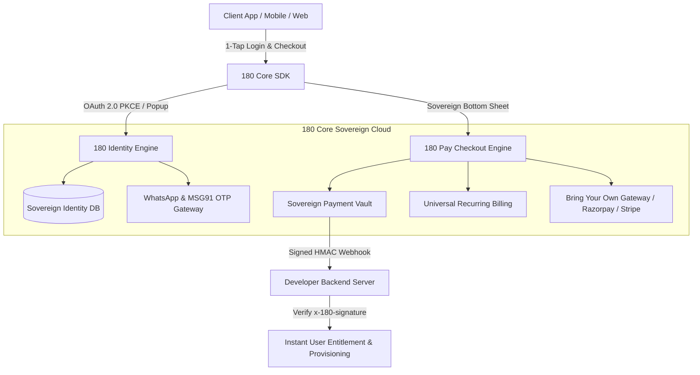

# 180 Core Platform Architecture

Welcome to the **180 Core Platform** documentation. 180 Core provides developers with a sovereign, zero-friction infrastructure layer combining **Universal Authentication (180 Identity)** and **1-Click Sovereign Payments (180 Pay)** into any web, mobile, or desktop application.



---

## The Dual Pillars of 180 Core

### 1. 180 Identity (Universal Sovereign Authentication)
- **Universal Single Sign-On**: Authenticate users across web and mobile using OAuth 2.0 + OpenID Connect with full PKCE protection.
- **WhatsApp 1-Tap OTP**: Zero-password, zero-friction authentication powered by instant WhatsApp and SMS verification.
- **Per-App Identity Isolation**: Usernames are scoped strictly per application (`AppUserIdentity`), guaranteeing that username collisions never spill between different developer apps.
- **15-Minute Ephemeral Access Tokens & 7-Day Rotating Refresh Tokens**: High-security token lifecycle preventing persistent breach exposure.
- **Central User Revocation**: Developers can immediately revoke active sessions from their console or via server-to-server REST API.

### 2. 180 Pay (1-Click Sovereign Payments & Subscriptions)
- **1-Click Bottom Sheet & Popup Checkout**: Ultra-fast UPI, Sovereign Wallet, Credit Card, and Netbanking modal checkout that eliminates 90% of gateway redirection drop-offs.
- **Universal Recurring Subscriptions**: Built-in monthly and annual recurring subscription management with automated dunning cycles, trial periods, and grace windows.
- **Embeddable Pricing Tables**: Plug-and-play Web Component (`<one-eighty-pricing-table>`), React component, and headless JSON API.
- **Bring Your Own Gateway (BYOG)**: Developers can use 180 Platform default rails or connect their own Razorpay / Stripe credentials directly.
- **Dynamic Geo-Pricing**: Automated IP-based country detection that presents local currencies (INR, USD, EUR, GBP, BRL) with custom purchasing power parity (PPP) discounts.
- **HMAC SHA-256 Webhook Verification**: High-security, cryptographically signed webhook notifications with timestamp-based replay attack defense.

---

## 3 API Credentials Model

Every developer application in 180 Workspace receives three cryptographic keys:

| Key Name | Prefix | Visibility | Purpose |
| :--- | :--- | :--- | :--- |
| **Client ID** | `180_client_...` | Public | Identifies your application in SDKs, login URLs, and checkout sheets. |
| **Client Secret** | `180_secret_...` | Server-Only | Authorizes backend token exchanges and server-to-server checkout session creation. |
| **Webhook Secret** | `whsec_...` | Server-Only | Verifies HMAC SHA-256 signatures on incoming webhook notifications (`x-180-signature`). |

:::caution Security First
Never expose your `CLIENT_SECRET` or `WEBHOOK_SECRET` in frontend client code, git repositories, or mobile bundles. Store them in secure environment variables (`.env`).
:::

---

---

## 💡 The "Zero Custom Screen" Mandate

A foundational architectural invariant of the 180 Core platform is that **developers NEVER need to build, style, or maintain custom authentication or checkout screens**.

### 1. For 180 Identity (Zero Custom Auth Screens)
- **Do developers need to build custom login UI? NO.**
- Developers do **NOT** build:
  - ❌ Login or sign-in screens
  - ❌ User registration or sign-up forms
  - ❌ WhatsApp 1-Tap OTP or SMS verification popups
  - ❌ Biometric Passkey / WebAuthn enrollment modals
  - ❌ Forgot password or account recovery flows
  - ❌ 2-Factor Authentication (2FA) screens
  - ❌ OAuth 2.0 Consent dialogs
- **How it integrates**:
  1. **In-DOM Bottom Sheet / Glass Modal (Web)**: With 1 line (`OneEighty.signIn({ uxMode: 'bottom_sheet' })`), an adaptive sheet slides up on mobile or an ultra-sleek glass modal opens on desktop. The user never leaves your application.
  2. **Drop-in Web Component**: `<one-eighty-auth-button>` (HTML) or `<OneEightyButton />` (React) renders an animated, responsive button that triggers the full flow.
  3. **Native Mobile (Flutter / React Native / iOS / Android)**: Launch `https://profile.180core.cloud/auth/login?client_id=...` in an In-App WebView or Custom Tab. Once authenticated, 180 Identity redirects to the custom URI scheme (e.g. `myapp://oauth/callback?code=...`) or communicates directly via the `OneEightyMobileChannel` bridge.

### 2. For 180 Pay (Zero Custom Payment Screens)
- **Do developers need to build custom payment UI? NO.**
- Developers do **NOT** build:
  - ❌ Payment method selector screens
  - ❌ Credit / Debit card input forms
  - ❌ UPI QR codes or Intent triggers
  - ❌ Coupon code validation & discount math
  - ❌ World Bank PPP purchasing power parity currency conversion logic
  - ❌ 3D Secure OTP verification screens
  - ❌ Receipt generation & fulfillment screens
- **How it integrates**:
  1. **Adaptive Bottom Sheet / Modal (Web)**: Call `OneEightyPay.checkout({ amount: 499, currency: 'INR' })`. The bottom sheet slides up, handles method selection (UPI, Cards, Netbanking, Prepaid Wallet, PPP Discounts), and resolves securely.
  2. **Hosted Checkout Screen (Mobile WebViews)**: Open `https://profile.180core.cloud/checkout/:sessionId`. On payment capture, 180 Pay posts to `OneEightyPaymentChannel` and redirects back to the mobile custom scheme (`myapp://payment/callback?status=success&session_id=...&amount=499`) with full transaction query parameters.
  3. **Shareable Payment Links (`/pay/l/:slug`)**: Completely zero-code. Generate a link and share it anywhere.
  4. **Drop-in Component**: `<one-eighty-pay-button amount="499" currency="INR" title="Upgrade Now"></one-eighty-pay-button>`.

---

## 🔄 Universal Parameter Normalization

180 Core's backend and SDK support seamless bidirectional mapping between snake_case (RFC standard) and camelCase (JavaScript/Dart standard):

| RFC / Snake Case | SDK / Camel Case | Alternate Aliases | Purpose |
| :--- | :--- | :--- | :--- |
| `client_id` | `clientId` | `app_id` | Registered application identifier |
| `redirect_uri` | `redirectUri` | `callback_url` | OAuth callback target |
| `return_url` | `returnUrl` | `success_url` | Payment success redirection target |
| `cancel_url` | `cancelUrl` | `cancel_uri` | Payment cancellation target |
| `order_id` | `orderId` | `orderReference` | Unique merchant order ID |
| `session_id` | `sessionId` | `checkoutSessionId` | Signed checkout session ID |
| `coupon_code` | `couponCode` | `coupon` | Promotional or PPP discount code |

---

## 📱 Mobile & Cross-Platform (Flutter / React Native) Guidelines

### 1. Custom URI Scheme Handling
To receive callbacks on native mobile devices:
- **Android (`AndroidManifest.xml`)**:
  ```xml
  <activity android:name=".MainActivity" android:exported="true">
    <intent-filter>
      <action android:name="android.intent.action.VIEW" />
      <category android:name="android.intent.category.DEFAULT" />
      <category android:name="android.intent.category.BROWSABLE" />
      <data android:scheme="myapp" android:host="oauth" />
      <data android:scheme="myapp" android:host="payment" />
    </intent-filter>
  </activity>
  ```
- **iOS (`Info.plist`)**:
  ```xml
  <key>CFBundleURLTypes</key>
  <array>
    <dict>
      <key>CFBundleURLSchemes</key>
      <array>
        <string>myapp</string>
      </array>
    </dict>
  </array>
  ```
- **Register Redirect URIs in Developer Console**:
  Add `myapp://oauth/callback` and `myapp://payment/callback` to **Allowed Redirect URIs** at [https://developer.180core.cloud](https://developer.180core.cloud).

### 2. Flutter In-App WebView Mobile Bridges
Flutter applications can communicate seamlessly with hosted 180 Core screens using JavaScript bridges:

```dart
InAppWebView(
  initialUrlRequest: URLRequest(url: WebUri("https://profile.180core.cloud/auth/login?client_id=$clientId&redirect_uri=$redirectUri")),
  onWebViewCreated: (controller) {
    controller.addJavaScriptHandler(
      handlerName: 'OneEightyMobileChannel',
      callback: (args) {
        final data = jsonDecode(args[0]);
        if (data['type'] == '180_IDENTITY_SUCCESS') {
          // Handle authentication code/token
        }
      },
    );
    controller.addJavaScriptHandler(
      handlerName: 'OneEightyPaymentChannel',
      callback: (args) {
        final data = jsonDecode(args[0]);
        if (data['type'] == '180_PAYMENT_SUCCESS') {
          // Handle payment confirmation
        }
      },
    );
  },
)
```

---

## 🌐 Authoritative Canonical Domains

| Service | Environment | URL | Key Role |
| :--- | :--- | :--- | :--- |
| **Developer Console** | Production | `https://developer.180core.cloud` | App Registration, OAuth Credentials, Allowed Origins |
| **Developer Console** | Local Dev | `http://localhost:3008` | Local developer dashboard |
| **180 Core Backend API** | Production | `https://api.180core.cloud` | OIDC Tokens, JWKS Keyring, UserInfo, 180 Pay APIs |
| **180 Core Backend API** | Local Dev | `http://localhost:4003` | Local OIDC and payment service |
| **Universal Identity UI / Profile & Checkout** | Production | `https://profile.180core.cloud` | In-DOM Bottom Sheet, WhatsApp OTP, Sovereign Checkout |
| **Universal Identity UI / Profile & Checkout** | Local Dev | `http://localhost:3009` | Local auth, profile and checkout UI |
| **Public JWKS Keyring** | Production | `https://api.180core.cloud/certs/jwks.json` | Stateless RS256 token validation |
| **Documentation Portal** | Production | `https://docs.180workspace.com` | Developer documentation & guides |
| **Documentation Portal** | Local Dev | `http://localhost:3005` | Local Docusaurus portal |

---

## Next Steps

- **[Master AI Integration Prompt](/docs/products/180-core/ai-master-prompt)**: Copy a ready-to-paste AI prompt for ChatGPT/Claude/Cursor to integrate 180 Identity and 180 Pay into any independent app in 2 minutes.
- **[180 Identity Integration](/docs/products/180-core/180-identity/getting-started)**: Step-by-step setup for Universal In-DOM Login & WhatsApp 1-Tap.
- **[180 Pay Integration](/docs/products/180-core/180-pay/getting-started)**: Step-by-step setup for 1-Click Payments & Recurring Subscriptions.
- **[Backend Token Verification](/docs/products/180-core/180-identity/backend-token-verification)**: Stateless RS256 JWKS validation & RFC 6749 code exchange.
- **[Webhook Verification Guide](/docs/products/180-core/180-pay/webhook-integration)**: Production code examples for verifying HMAC signatures in Node.js, Next.js, and Python.
