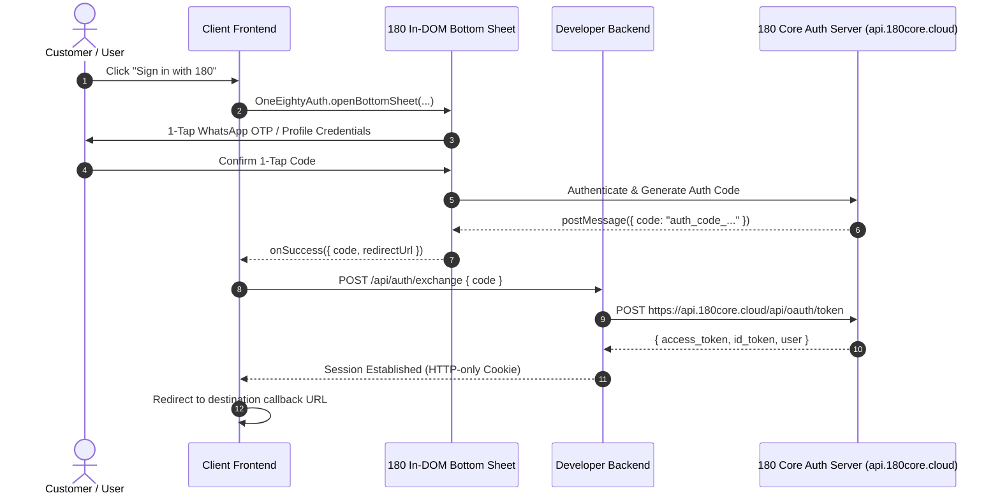

# 180 Identity Quickstart

> Looking for the public product overview, interactive login modal demo, and feature breakdown? Visit the [180 Identity WhatsApp OTP & Biometric Passkey Platform](https://180workspace.com/180-identity).

Integrate universal, zero-friction authentication into any independent application in under 25 lines of code.



---

## 1. Prerequisites

1. Register your application in the [180 Developer Console](https://developer.180core.cloud).
2. Note your **Client ID** (`180_client_...`) and **Client Secret** (`180_secret_...`).
3. Add your Allowed Origins & Redirect URI in Developer Console Settings:
   - For local development: `http://localhost:3000` or `http://localhost:5173`.
   - For production: `https://yourapp.com`.

---

## 2. Client-Side Integration

You can integrate 180 Identity using the official npm package, a lightweight script tag, or a declarative Web Component.

### Option A: Next.js App Router & React (`@workspace/identity-sdk`)

```bash
npm install @workspace/identity-sdk
```

```tsx
'use client';

import { OneEightyAuth } from '@workspace/identity-sdk';

export function LoginButton({ redirectUrl = '/dashboard' }: { redirectUrl?: string }) {
  const handleLogin = () => {
    OneEightyAuth.openBottomSheet({
      clientId: process.env.NEXT_PUBLIC_180_CLIENT_ID || '180_client_...',
      uxMode: 'bottom_sheet', // Responsive slide-up bottom sheet with zero popup blocker risk
      scope: 'openid identity:read identity:email identity:phone',
      onSuccess: async (data) => {
        // Exchange authorization code for authenticated session
        const res = await fetch('/api/auth/exchange', {
          method: 'POST',
          headers: { 'Content-Type': 'application/json' },
          body: JSON.stringify({ code: data.code }),
        });
        if (res.ok) {
          window.location.href = redirectUrl;
        }
      },
      onError: (err) => console.error('180 Login error:', err),
    });
  };

  return (
    <button onClick={handleLogin} className="px-6 py-3 rounded-2xl bg-indigo-600 hover:bg-indigo-500 text-white font-bold text-sm shadow-xl shadow-indigo-600/25">
      Sign in with 180 Profile
    </button>
  );
}
```

:::tip Zero Popup Blocker Hassle
Using `uxMode: 'bottom_sheet'` mounts an in-DOM iframe modal with smooth touch swipe dismiss, preventing Safari and Chrome Mobile from blocking popups.
:::

---

### Option B: Vanilla HTML / Single Script Tag (< 15 lines of code)

```html
<!-- 1. Include 180 Core SDK -->
<script src="https://profile.180core.cloud/sdk/v1/180-core-sdk.js" async></script>

<!-- 2. Login button -->
<button id="180-login-btn">Sign in with 180</button>

<script>
  document.getElementById('180-login-btn').addEventListener('click', function () {
    window.OneEightyAuth.openBottomSheet({
      clientId: 'YOUR_CLIENT_ID',
      uxMode: 'bottom_sheet',
      scope: 'openid identity:read identity:email',
      onSuccess: function (data) {
        console.log('Authenticated! Authorization code:', data.code);
        window.location.href = '/dashboard';
      },
      onError: function (err) {
        console.error('Login error:', err.message);
      }
    });
  });
</script>
```

---

### Option C: Declarative Web Component

```html
<script src="https://profile.180core.cloud/sdk/v1/180-core-sdk.js" async></script>

<one-eighty-login-sheet 
  client-id="YOUR_CLIENT_ID" 
  button-text="Sign in with 180" 
  redirect-url="/dashboard">
</one-eighty-login-sheet>
```

---

## 3. Server-Side Token Exchange (RFC 6749)

When your frontend receives `data.code`, exchange it securely on your backend using your `CLIENT_SECRET`:

```ts
// Next.js Route Handler: app/api/auth/exchange/route.ts
import { NextResponse } from 'next/server';

export async function POST(req: Request) {
  const { code } = await req.json();

  // 1. Exchange code for access & ID token
  const tokenResponse = await fetch('https://api.180core.cloud/api/oauth/token', {
    method: 'POST',
    headers: { 'Content-Type': 'application/json' },
    body: JSON.stringify({
      grant_type: 'authorization_code',
      code,
      client_id: process.env.NEXT_PUBLIC_180_CLIENT_ID,
      client_secret: process.env.ONE_EIGHTY_CLIENT_SECRET,
      redirect_uri: `${new URL(req.url).origin}/api/auth/callback`,
    }),
  });

  if (!tokenResponse.ok) {
    const errorBody = await tokenResponse.json();
    return NextResponse.json({ error: 'Token exchange failed', details: errorBody }, { status: 400 });
  }

  const { access_token, id_token, user } = await tokenResponse.json();

  // 2. Fetch verified user profile
  const userResponse = await fetch('https://api.180core.cloud/api/oauth/userinfo', {
    headers: { Authorization: `Bearer ${access_token}` },
  });
  const verifiedUser = await userResponse.json();

  // 3. Establish session cookie
  const res = NextResponse.json({ success: true, user: verifiedUser });
  res.cookies.set('session', access_token, { 
    httpOnly: true, 
    secure: process.env.NODE_ENV === 'production',
    sameSite: 'lax',
    maxAge: 60 * 60 * 24 * 7 
  });
  return res;
}
```

---

## 4. Scopes Reference

| Scope | Description |
| :--- | :--- |
| `openid` | Standard OIDC subject identifier (`sub`). Mandatory. |
| `identity:read` | Public profile information: name, avatar, bio. |
| `identity:email` | Verified email address. |
| `identity:phone` | Verified telephone number (WhatsApp / SMS verified). |

Next, explore the [Backend Verification Guide](./backend-token-verification) for stateless RS256 JWKS verification or [SDK Reference](./sdk-reference).
