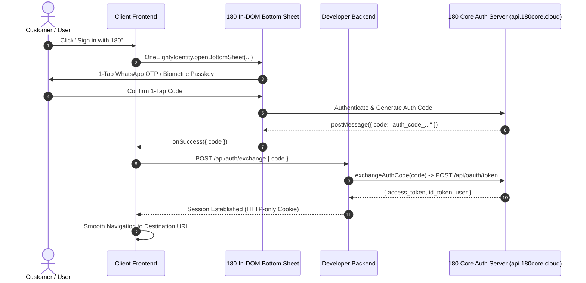

# 180 Identity Quickstart & Architecture

> Looking for the public product overview, interactive login modal demo, and feature breakdown? Visit the [180 Identity WhatsApp OTP & Biometric Passkey Platform](https://180workspace.com/180-identity).

Integrate universal, zero-friction authentication into any independent application in under 60 seconds with **3 lines of code**.



---

## 🌐 Authoritative Dual-Domain Ecosystem Directory

| Domain | Role & Purpose | Canonical Endpoints |
| :--- | :--- | :--- |
| **`profile.180core.cloud`** | **Hosted User Interfaces & CDN SDK**<br/>(Universal SSO, WhatsApp 1-Tap OTP, 1-Click Sovereign Checkout) | `GET /auth/login`<br/>`GET /checkout`<br/>`GET /sdk/v1/180-core-sdk.js`<br/>`GET /.well-known/openid-configuration` |
| **`api.180core.cloud`** | **Core Engine REST APIs**<br/>(RFC 6749 Code Exchange, OIDC Profile & JWKS) | `POST /api/oauth/token`<br/>`GET /api/oauth/userinfo`<br/>`GET /certs/jwks.json` |
| **`developer.180core.cloud`** | **Developer Management Console** | Client IDs, Secrets, Allowed Origins |

---


:::tip Universal Parameter Normalization
180 Core's OAuth engine seamlessly accepts both RFC 6749 `snake_case` and JavaScript/Dart `camelCase`:
- `client_id` ↔ `clientId`
- `redirect_uri` ↔ `redirectUri`
- `response_type` ↔ `responseType`
- `code_challenge` ↔ `codeChallenge`
- `state`
:::

## 💡 The "Zero Custom Screen" Mandate (Zero UI Requirement)

**Is any custom screen required? NO.**

Developers do **NOT** build or maintain:
- ❌ Login or sign-in screens
- ❌ User registration or sign-up forms
- ❌ WhatsApp 1-Tap OTP or SMS verification popups
- ❌ Biometric Passkey / WebAuthn enrollment modals
- ❌ Forgot password or account recovery flows
- ❌ 2-Factor Authentication (2FA) screens
- ❌ OAuth 2.0 Consent dialogs

### How It Integrates (3 Pre-Built Options):
1. **In-DOM Bottom Sheet / Glass Modal (Web)**: With 1 line (`OneEighty.signIn({ uxMode: 'bottom_sheet' })` or `OneEightyIdentity.openBottomSheet({ clientId: '...' })`), an adaptive sheet slides up on mobile or an ultra-sleek glass modal opens on desktop. The user never leaves the developer's app.
2. **Drop-in Web Component**: `<one-eighty-auth-button>` (HTML) or `<OneEightyButton />` (React) renders an animated, responsive button that triggers the full flow.
3. **Native Mobile (Flutter / React Native / iOS / Android)**: Launch `https://profile.180core.cloud/auth/login?client_id=...` in an In-App WebView or Custom Tab. Once authenticated, 180 Identity redirects to the custom URI scheme (e.g. `myapp://oauth/callback?code=...`) or communicates via the `OneEightyMobileChannel` bridge.

### 📱 Mobile & Cross-Platform (Flutter / React Native) Setup
- **Custom URI Scheme Registration**:
  - Android (`AndroidManifest.xml`): `<data android:scheme="myapp" android:host="oauth" />`
  - iOS (`Info.plist`): Add `myapp` under `CFBundleURLSchemes`
  - Console: Add `myapp://oauth/callback` under Allowed Redirect URIs in [https://developer.180core.cloud](https://developer.180core.cloud)
- **Flutter In-App WebView Bridge**:
```dart
InAppWebView(
  initialUrlRequest: URLRequest(url: WebUri("https://profile.180core.cloud/auth/login?client_id=$clientId&redirect_uri=$redirectUri")),
  onWebViewCreated: (controller) {
    controller.addJavaScriptHandler(
      handlerName: 'OneEightyMobileChannel',
      callback: (args) {
        final data = jsonDecode(args[0]);
        if (data['type'] == '180_IDENTITY_SUCCESS') {
          // Handle authentication code/token
        }
      },
    );
  },
)
```
- **Flutter Web Path Routing**: RFC 6749 Section 3.1.2 strictly prohibits fragment identifiers (`#`) in OAuth redirect URIs. Ensure Flutter Web apps invoke `usePathUrlStrategy()` from `package:flutter_web_plugins/url_strategy.dart` so redirect URLs are clean (e.g. `http://localhost:3000/auth/callback`).

## 🚀 The New Reality: Integrated in 60 Seconds

We engineered all OAuth complexity into the core platform so that third-party developers and AI coding agents only have to write 3 to 5 lines of intuitive code:

### 1. Client-Side (React / Next.js / Vite SPA)

```tsx
'use client';

import { OneEightyIdentity } from '@workspace/identity-sdk';

export function LoginButton({ redirectUrl = '/dashboard' }: { redirectUrl?: string }) {
  const handleLogin = () => {
    // 1. Opens non-blocking in-DOM slide-up sheet (zero popup blockers!)
    OneEightyIdentity.openBottomSheet({
      clientId: process.env.NEXT_PUBLIC_180_CLIENT_ID!,
      onSuccess: async ({ code }) => {
        // 2. Exchange code with your backend
        const res = await fetch('/api/auth/exchange', {
          method: 'POST',
          headers: { 'Content-Type': 'application/json' },
          body: JSON.stringify({ code }),
        });
        if (res.ok) window.location.href = redirectUrl;
      },
    });
  };

  return (
    <button onClick={handleLogin} className="px-5 py-2.5 rounded-xl bg-indigo-600 hover:bg-indigo-500 text-white font-semibold text-sm shadow-md">
      Sign in with 180 Profile
    </button>
  );
}
```

*Vanilla HTML Alternative*:
```html
<script src="https://profile.180core.cloud/sdk/v1/180-core-sdk.js" async></script>
<button onclick="window.OneEightyAuth.openBottomSheet({ clientId: 'YOUR_CLIENT_ID', onSuccess: ({ code }) => fetch('/api/auth/exchange', { method: 'POST', body: JSON.stringify({ code }) }) })">
  Sign in with 180
</button>
```

### 2. Server-Side Token Exchange (1 Line)

```typescript
// app/api/auth/exchange/route.ts (Next.js App Router) or Express/Fastify
import { NextResponse } from 'next/server';
import { exchangeAuthCode } from '@workspace/identity-sdk';

export async function POST(req: Request) {
  const { code } = await req.json();

  // Exchange code for user profile and tokens in 1 line:
  const { user, tokens } = await exchangeAuthCode(code, {
    clientId: process.env.NEXT_PUBLIC_180_CLIENT_ID,
    clientSecret: process.env.ONE_EIGHTY_CLIENT_SECRET,
  });

  console.log('Logged in user:', user.name, user.email, user.phone_number);

  // Set secure HTTP-only session cookie
  const response = NextResponse.json({ success: true, user });
  response.cookies.set('session', tokens.access_token, {
    httpOnly: true,
    secure: process.env.NODE_ENV === 'production',
    sameSite: 'lax',
    maxAge: 60 * 60 * 24 * 7,
  });
  return response;
}
```

---

## 🛡️ Behind the Scenes: Why It's Robust

### 1. RFC 8252 Dynamic Loopback Matching
During local development, your dev server might jump from port `3000` to `3005` or `5173`. With 180 Identity, any loopback origin (`localhost`, `127.0.0.1`, `10.0.2.2` Android emulator, `::1`) is automatically matched under RFC 8252 recommendations. You never have to manually whitelist every dynamic localhost port in the console.

### 2. OIDC Core 1.0 Universal Normalization
Calling `/api/oauth/userinfo` returns standard OpenID Connect claims:
- Standard claims: `sub`, `name`, `preferred_username`, `email`, `phone_number`, `picture`
- Legacy compatibility aliases: `phone`, `phoneNumber`, `username`, `avatarUrl`
- Nested user object: `user: { ... }`

No database schema (e.g., Prisma, Drizzle, TypeORM) ever crashes due to field naming discrepancies.

### 3. Stateless RS256 Verification
Microservices and edge workers can verify Bearer tokens locally in `<1ms` without database queries or outbound network roundtrips using the public JWKS Keyring:
`https://api.180core.cloud/certs/jwks.json`.

Explore the [Backend Verification Guide](./backend-token-verification) or the [SDK Reference](./sdk-reference) for NextAuth and Flutter examples.
