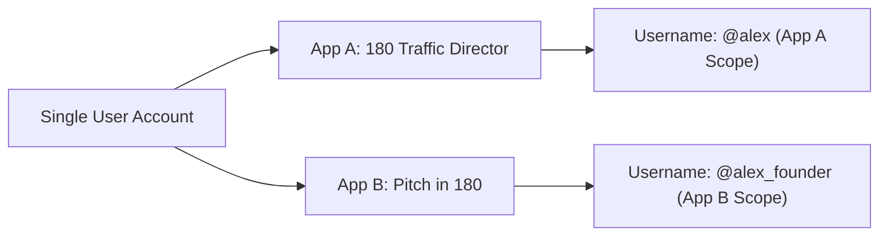

# Universal Login Flow & UX Modes

180 Identity supports three distinct display modes to maximize conversion on desktop, mobile, and web apps:

| Display Mode | Recommended Device | Behavior |
| :--- | :--- | :--- |
| **`bottom_sheet`** | **All Devices (Default & Recommended)** | Slides up an in-DOM, mobile touch-friendly modal with WhatsApp 1-tap OTP and credential login. Zero popup blocker failure on Safari iOS, Chrome Android, and privacy-shielded browsers. |
| **`popup`** | Desktop Windows / Web Apps | Launches a centered `450x680` authentication window communicating via `postMessage`. Closes automatically upon authentication. |
| **`redirect`** | Server-Rendered / Multi-Page Apps | Navigates the full browser to `https://profile.180core.cloud/auth/login` and redirects back to your registered `redirect_uri` upon completion. |

---

## 1. Configuring Display Modes in the Developer Console

In the **[180 Developer Console](https://developer.180core.cloud)** under **App Settings -> Auth Display Preferences**, you can:
- Enable or disable specific UX modes for your application.
- Set device-specific defaults (e.g. `bottom_sheet` everywhere).

---

## 2. Using PKCE (Proof Key for Code Exchange)

For Single Page Applications (SPAs) or mobile apps that cannot securely store a `CLIENT_SECRET`, 180 Identity supports **RFC 7636 PKCE** using `S256` code challenges.

### Generating Code Verifier and Challenge:
```ts
function generateCodeVerifier(): string {
  const array = new Uint8Array(32);
  crypto.getRandomValues(array);
  return Array.from(array, dec => dec.toString(16).padStart(2, '0')).join('');
}

async function generateCodeChallenge(verifier: string): Promise<string> {
  const encoder = new TextEncoder();
  const data = encoder.encode(verifier);
  const digest = await crypto.subtle.digest('SHA-256', data);
  return btoa(String.fromCharCode(...new Uint8Array(digest)))
    .replace(/\+/g, '-')
    .replace(/\//g, '_')
    .replace(/=+$/, '');
}
```

### Passing PKCE to Authorization URL:
```text
https://profile.180core.cloud/auth/login?
  client_id=180_client_...&
  redirect_uri=https://yourapp.com/callback&
  response_type=code&
  scope=openid identity:read&
  code_challenge=E9Melhoa2OwvFrEMTJguCHaoeK1t8URWbuGJSstw-cM&
  code_challenge_method=S256&
  state=secure_random_state_string&
  ux_mode=bottom_sheet
```

---

## 3. Per-App Username Isolation

Unlike legacy identity providers where usernames are global across the whole internet, 180 Identity enforces **cryptographic per-app isolation**:



When querying `GET /api/oauth/userinfo`, the returned `username` field is guaranteed to be unique and scoped specifically to your application. A user choosing `@satoshi` in App A does not prevent another user from claiming `@satoshi` in App B.
