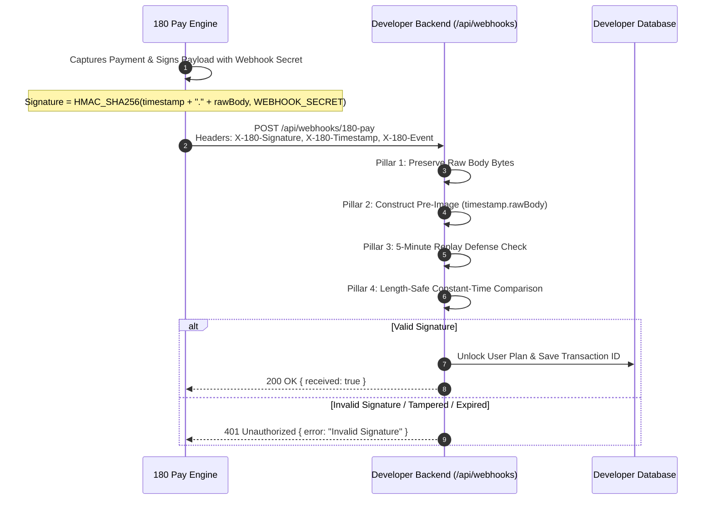

# Webhook Integration & Cryptographic HMAC Verification

When a payment succeeds, relying solely on client-side frontend redirects (e.g. `onSuccess` callback) is dangerous. Customers might close their browser tab, experience network drops, or attempt client-side spoofing.

**Webhooks are server-to-server HTTP POST notifications sent directly from 180 Core to your backend.** They guarantee that your application provisions user entitlements only after funds are cryptographically captured and verified.



---

## 🏛️ The 4 Pillars of Authentic Webhook Processing

To prevent replay attacks, timing leaks, and serialization mismatches, your backend must implement the 4 architectural pillars:

1. **Raw Body Preservation**:
   - In **Fastify 5.x**: Register `@fastify/raw-body` with `{ field: 'rawBody', global: false, encoding: 'utf8', runFirst: true }`. Fastify's default JSON re-serializer alters key order and byte lengths, corrupting HMAC calculations.
   - In **Express**: Mount `express.raw({ type: '*/*' })` directly on the webhook route *before* `express.json()`.
   - In **Next.js (App Router)**: Read `await req.text()` directly.
   - In **Python (FastAPI)**: Read `await request.body()`.
2. **Canonical Pre-Image**: Signature is computed across `${timestamp}.${rawBody}` using your secret `ONE_EIGHTY_WEBHOOK_SECRET`.
3. **Replay Window Defense**: Discard requests where `Math.abs(Date.now() / 1000 - timestamp) > 300` (5 minutes) to protect against replay attacks.
4. **Length-Safe Constant-Time Comparison**: Guard length check (`bufA.length === bufB.length`) before calling `crypto.timingSafeEqual(bufA, bufB)` to prevent `RangeError`.

---

## 📦 Webhook Security Headers

Every webhook dispatch includes four security headers:

| Header Name | Format | Purpose |
| :--- | :--- | :--- |
| **`X-180-Signature`** | Hex string (64 chars) | Cryptographic HMAC-SHA256 signature calculated over `${timestamp}.${rawBody}` using your application's `WEBHOOK_SECRET`. |
| **`X-180-Timestamp`** | Integer string (e.g. `1728135600`) | Unix epoch seconds when the webhook was dispatched. Protects against replay attacks. |
| **`X-180-Event`** | String (e.g. `payment.captured`) | The event type being triggered. |
| **`User-Agent`** | `180-Pay-Webhook-Dispatcher/2.0` | Identifies the official 180 Pay webhook dispatcher daemon. |

---

## 📋 Webhook Event Catalog

| Event Name | When Fired | Key Payload Fields |
| :--- | :--- | :--- |
| **`payment.captured`** | A one-time payment or checkout session is authorized and captured. | `orderId`, `sessionId`, `transactionId`, `amount`, `currency`, `customerEmail`, `metadata` |
| **`subscription.created`** | A new recurring subscription is activated (trial or paid). | `subscriptionId`, `planCode`, `amount`, `currentPeriodEnd`, `customerEmail`, `metadata` |
| **`subscription.renewed`** | Monthly/annual subscription successfully auto-debited. | `subscriptionId`, `amount`, `nextBillingDate`, `transactionId` |
| **`subscription.cancelled_by_customer`** | Customer cancels renewal through the customer portal. | `subscriptionId`, `planCode`, `cancelReason`, `currentPeriodEnd` |
| **`coupon.redeemed`** | A promotional discount code was applied during checkout. | `couponCode`, `discountAmount`, `sessionId` |
| **`identity.user.revoked`** | A user session was revoked from the Developer Console. | `userId`, `appId`, `revokedAt` |

---

## ⚡ Turnkey 1-Line Webhook Verification (`constructWebhookEvent`)

If using `@workspace/identity-sdk`, the SDK provides a pre-built, hardened verifier that handles all 4 pillars automatically:

```typescript
import { constructWebhookEvent } from '@workspace/identity-sdk';

const event = constructWebhookEvent(
  rawBody,
  req.headers['x-180-signature'],
  process.env.ONE_EIGHTY_WEBHOOK_SECRET!,
  req.headers['x-180-timestamp']
);
```

---

## 🛠️ Production Code Implementations

### A. Node.js (Fastify 5.x)
In Fastify 5.x, you **must** register `@fastify/raw-body` to capture the unparsed request string:

```typescript
import Fastify from 'fastify';
import rawBody from '@fastify/raw-body';
import { constructWebhookEvent } from '@workspace/identity-sdk';

const fastify = Fastify();

// 1. Register raw body plugin to capture untouched bytes
await fastify.register(rawBody, {
  field: 'rawBody',
  global: false,
  encoding: 'utf8',
  runFirst: true,
});

fastify.post('/api/webhooks/180-pay', { config: { rawBody: true } }, async (req, reply) => {
  try {
    const rawPayload = (req as any).rawBody;
    const signature = req.headers['x-180-signature'] as string;
    const timestamp = req.headers['x-180-timestamp'] as string;
    const secret = process.env.ONE_EIGHTY_WEBHOOK_SECRET!;

    // Turnkey verification
    const event = constructWebhookEvent(rawPayload, signature, secret, timestamp);

    // Handle events
    switch (event.event) {
      case 'payment.captured': {
        const { orderId, amount, currency, customerEmail } = event.data;
        console.log(`Verified payment of ${currency} ${amount} for order ${orderId}`);
        // Fulfill order in your database
        break;
      }
      case 'subscription.renewed': {
        const { subscriptionId, nextBillingDate } = event.data;
        console.log(`Subscription ${subscriptionId} extended to ${nextBillingDate}`);
        break;
      }
    }

    return reply.status(200).send({ received: true });
  } catch (err: any) {
    req.log.error(err, 'Webhook verification failed');
    return reply.status(401).send({ error: err.message });
  }
});
```

### B. Node.js (Express)
In Express, mount `express.raw` *specifically* before `express.json()`:

```javascript
const express = require('express');
const { constructWebhookEvent } = require('@workspace/identity-sdk');

const app = express();

// 1. Preserve raw body specifically on the webhook endpoint
app.post(
  '/api/webhooks/180-pay',
  express.raw({ type: '*/*' }),
  (req, res) => {
    try {
      const rawBody = req.body.toString('utf8');
      const signature = req.headers['x-180-signature'];
      const timestamp = req.headers['x-180-timestamp'];
      const secret = process.env.ONE_EIGHTY_WEBHOOK_SECRET;

      // 1-Line Verification
      const event = constructWebhookEvent(rawBody, signature, secret, timestamp);

      if (event.event === 'payment.captured') {
        const { orderId, amount, currency } = event.data;
        console.log(`Payment confirmed: ${orderId} (${currency} ${amount})`);
        // Fulfill user entitlement
      }

      res.status(200).json({ received: true });
    } catch (err) {
      console.error('Webhook verification error:', err.message);
      res.status(401).json({ error: err.message });
    }
  }
);

// Standard JSON parser for all other routes
app.use(express.json());

app.listen(4000, () => console.log('Listening on port 4000'));
```

### C. Next.js App Router (`app/api/webhooks/180-pay/route.ts`)

```typescript
import { NextResponse } from 'next/server';
import { constructWebhookEvent } from '@workspace/identity-sdk';

export async function POST(req: Request) {
  try {
    // 1. Read raw body as text (DO NOT call req.json() first)
    const rawBody = await req.text();
    const signature = req.headers.get('x-180-signature');
    const timestamp = req.headers.get('x-180-timestamp');
    const secret = process.env.ONE_EIGHTY_WEBHOOK_SECRET!;

    // 2. Turnkey verification
    const event = constructWebhookEvent(rawBody, signature, secret, timestamp);

    // 3. Fulfill purchase idempotently
    if (event.event === 'payment.captured') {
      const { orderId, amount, currency, customerEmail } = event.data;
      console.log(`Fulfilling purchase for: ${customerEmail} (Order: ${orderId})`);
      // await db.orders.updateStatus(orderId, 'PAID');
    }

    return NextResponse.json({ received: true });
  } catch (err: any) {
    return NextResponse.json({ error: err.message }, { status: 401 });
  }
}
```

### D. Python (FastAPI)

```python
import hmac
import hashlib
import time
from fastapi import FastAPI, Request, HTTPException

app = FastAPI()
WEBHOOK_SECRET = "whsec_live_..."

@app.post("/api/webhooks/180-pay")
async def handle_180_webhook(request: Request):
    raw_body = await request.body()
    signature = request.headers.get("x-180-signature")
    timestamp = request.headers.get("x-180-timestamp")

    if not signature or not timestamp:
        raise HTTPException(status_code=400, detail="Missing signature or timestamp")

    # 1. 5-minute replay window check
    current_time = int(time.time())
    if abs(current_time - int(timestamp)) > 300:
        raise HTTPException(status_code=401, detail="Webhook timestamp expired")

    # 2. Compute canonical HMAC-SHA256 signature
    sign_payload = f"{timestamp}.{raw_body.decode('utf-8')}".encode("utf-8")
    expected_sig = hmac.new(WEBHOOK_SECRET.encode("utf-8"), sign_payload, hashlib.sha256).hexdigest()

    # 3. Constant-time comparison
    if not hmac.compare_digest(signature, expected_sig):
        raise HTTPException(status_code=401, detail="Invalid HMAC signature")

    payload = await request.json()
    event_type = payload.get("event")
    data = payload.get("data", {})

    if event_type == "payment.captured":
        print(f"Payment Captured: Order {data.get('orderId')} for {data.get('currency')} {data.get('amount')}")
        # Fulfill order in your database

    return {"received": True}
```

---

## 5. Testing Webhooks Locally

1. Start your local dev server (e.g. `npm run dev` on port 3000).
2. Start an [ngrok](https://ngrok.com) tunnel:
   ```bash
   ngrok http 3000
   ```
3. Copy your ngrok URL: `https://abc-123.ngrok-free.app/api/webhooks/180-pay`.
4. In the **[180 Developer Console](https://developer.180core.cloud)**, navigate to **Webhooks**, paste the URL, and click **Send Test Webhook**.
5. Your terminal will instantly log the received and verified event!
