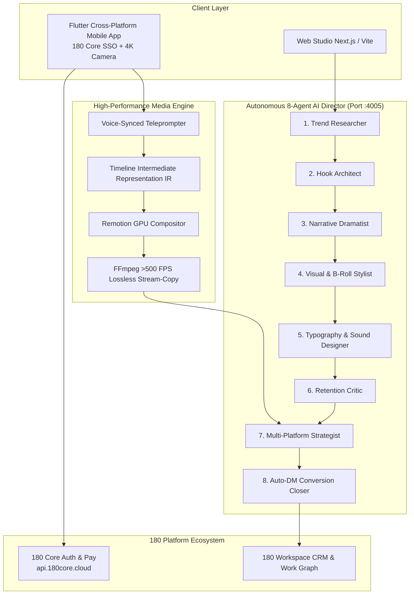

# 180 Social Studio Platform Architecture

**180 Social Studio** is the autonomous AI social media and video production workstation built for creators, media agencies, high-velocity growth teams, and independent founders.

Instead of paying for 5–7 disconnected subscriptions (ChatGPT for scripts, PromptSmart for teleprompters, CapCut/Premiere for editing, Buffer for scheduling, ManyChat for DM automation, and HubSpot for CRM leads), 180 Social Studio unifies the entire creation-to-cash pipeline on the **180 Sovereign Work Graph**.

---

## Autonomous 8-Agent AI Director

At the heart of Social Studio is a specialized multi-agent director that autonomously transforms a raw concept, product URL, or voice memo into high-converting video assets:

| Agent | Specialized Role | Execution Output |
| :--- | :--- | :--- |
| **1. Trend & Intelligence Agent** | Analyzes top-performing hooks, audio trends, and viral formats across TikTok, Instagram Reels, and YouTube Shorts. | Viral trend brief & pattern interrupt angles |
| **2. Hook Architect** | Crafts 3-second visual and verbal opening hooks designed for >70% 3-second hold rates. | 5 hook variations with behavioral psychology tags |
| **3. Narrative Dramatist** | Structures scripts following proven retention frameworks (Problem → Agitate → Solve → Proof → CTA). | Full production script with teleprompter timing |
| **4. Visual & B-Roll Stylist** | Maps script timestamps to kinetic B-roll clips, stock assets, AI image generations, and screen recordings. | Visual storyboard & asset acquisition manifest |
| **5. Kinetic Typography & Audio Designer** | Generates word-level synchronized karaoke subtitles, sound effect risers, whooshes, and audio dips. | Subtitle styling manifest & audio mix timeline |
| **6. Retention Critic Agent** | Evaluates script and pacing against second-by-second drop-off models, flagging drag spots. | Pacing score (0–100) & edit recommendations |
| **7. Multi-Platform Compliance Strategist** | Adapts aspect ratios (9:16 vertical, 16:9 horizontal, 1:1 square), tags, character limits, and posting times. | Platform-tailored payloads for 6 networks |
| **8. Auto-DM & Conversion Closer** | Programs keyword comment triggers (`"SCALE"`, `"TEMPLATE"`), interactive DM sequences, and CRM attribution. | Automated DM funnel & 180 Pay checkout link |

---

## High-Performance Video Engine Architecture

Social Studio couples WebGPU client rendering with an enterprise server-side video rendering pipeline operating on port `:4005`:

### 1. Timeline Intermediate Representation (Timeline IR)
Video edits are stored as declarative JSON timelines specifying tracks, clips, transitions, animated text layers, and audio volumes. Timelines can be manipulated programmatically by AI agents or adjusted by creators with sub-frame precision.

### 2. Lossless Smart Stream-Splicing (>500 FPS)
For jump-cuts, pauses, and silence removal in camera recordings, Social Studio employs **FFmpeg smart stream-copy**. By cutting on keyframes without re-encoding untouched video frames, clip assembly runs at over **500 frames per second**, exporting a 60-second video in under 2 seconds.

### 3. Remotion GPU Composition
Complex animations, animated charts, kinetic typography, and motion overlays are rendered via headless Remotion render workers, outputting pristine 1080p60 or 4K ProRes/H.264 video.

### 4. Hardware-Synced Mobile Teleprompter (Flutter)
The companion Flutter mobile app provides front-camera recording with speech-recognition auto-scrolling:
- Uses local on-device Vosk / Whisper speech models to scroll the teleprompter exactly as you speak.
- Allows recording multiple hook takes with 1-tap bookmarking for instant timeline insertion.
- Authenticates seamlessly using **180 Core Universal SSO** (`profile.180core.cloud`).

---

## 1-Click Multi-Platform Publishing & Attribution

Connect your social channels once and publish across the entire landscape:

- **Supported Channels**: Instagram (Reels & Feed), YouTube (Shorts & Long-Form), TikTok, X (Twitter), LinkedIn, and Facebook Pages.
- **Smart Queue & Best-Time AI**: Distributes content according to your audience's unique historical engagement heatmaps.
- **Closed-Loop ROI Tracking**: Matches video views and comments to actual downstream CRM opportunities and Stripe/180 Pay revenue.

---

## Viral Auto-DM Lead Capture Pipeline

When viewers comment keywords on your posts:
1. **Instant Webhook Ingestion**: Comment received within 150ms.
2. **Autonomous DM Dispatch**: Sends a personalized private message with the requested resource, booking link, or coupon code.
3. **Conversational Qualification**: Chatbot collects email, phone number, and company size.
4. **Instant CRM Deal Sync**: Enriched lead is immediately logged in **180 Workspace CRM** with the originating video ID, attribution UTMs, and transaction history.

---

## Microservices Ports & Architecture Map

| Component | Port | Environment | Technology |
| :--- | :--- | :--- | :--- |
| **Social Studio Backend API** | `4005` | Production / Local | Node.js Express, FFmpeg, Whisper, Remotion Engine |
| **Social Studio Mobile App** | Mobile | iOS / Android | Flutter Cross-Platform, CameraX, 180 Core SSO |
| **180 Core Identity & Pay** | `4003` / `https://api.180core.cloud` | Production | Universal OIDC, RS256 JWKS, 180 Pay |
| **180 Workspace Graph** | `4000` / `https://app.180workspace.com` | Production | Unified Work Graph, CRM, Multi-Company RBAC |

---

## Documentation Index

- **[Auto-DM Automation](/docs/products/180-social-studio/auto-dm-automation)**: Set up keyword triggers, automated conversation flows, and lead qualification funnels.
- **[Multi-Platform Publishing](/docs/products/180-social-studio/multi-platform-publishing)**: Connect your social accounts, schedule queues, and adapt video formats across 6 networks.
- **[AI Script Director](/docs/products/180-social-studio/ai-script-director)**: Generate viral hooks, full production scripts, and custom brand voice profiles.
- **[Inbuilt Teleprompter Camera](/docs/products/180-social-studio/inbuilt-teleprompter-camera)**: Record flawless takes with voice-synced auto-scrolling and magnetic eye contact.
- **[Multi-Track Video Timeline Engine](/docs/products/180-social-studio/video-editor-and-timeline)**: Edit videos with 60fps WebGPU rendering, lossless stream splicing, auto-zoom, and kinetic captions.
- **[Analytics & Visual Calendar](/docs/products/180-social-studio/analytics-and-calendar)**: Monitor cross-platform engagement, audience retention curves, and content calendars.
- **[Creator Playbook & Workflows](/docs/products/180-social-studio/creator-playbook-and-workflows)**: Step-by-step master workflow: from blank page to viral video and paid clients in 15 minutes.
- **[Mobile App & SSO Architecture](/docs/products/180-social-studio/mobile-app-and-sso)**: Flutter cross-platform architecture, CameraX teleprompter, and 180 Core Universal SSO PKCE integration.
