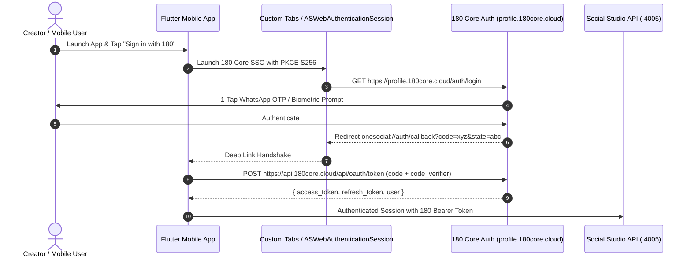
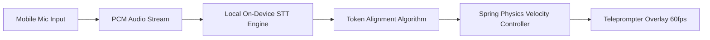

# 180 Social Studio Mobile App & SSO Architecture

The **180 Social Studio Mobile App** (`social-studio-mobile`) is a high-performance cross-platform mobile workstation engineered with Flutter for iOS and Android. It delivers hardware-accelerated 4K front-camera recording, an on-device speech-synced teleprompter, and seamless single sign-on via **180 Core Identity**.



---

## 1. 180 Core SSO Integration (OAuth 2.0 + RFC 7636 PKCE)

The mobile app operates as a public OAuth client (`client_id: 180-social-studio-mobile`). Because client secrets cannot be securely embedded in mobile binary bundles, authentication is strictly enforced via **Proof Key for Code Exchange (PKCE)** using `S256` hashing.

### Launching Universal SSO in Flutter:

```dart
import 'package:flutter_custom_tabs/flutter_custom_tabs.dart';
import 'package:crypto/crypto.dart';
import 'dart:convert';
import 'dart:math';

class OneEightyMobileAuth {
  static const String clientId = '180-social-studio-mobile';
  static const String redirectUri = 'onesocial://auth/callback';
  static const String authEndpoint = 'https://profile.180core.cloud/auth/login';
  static const String tokenEndpoint = 'https://api.180core.cloud/api/oauth/token';

  static String generateCodeVerifier() {
    final random = Random.secure();
    final values = List<int>.generate(32, (i) => random.nextInt(256));
    return base64UrlEncode(values).replaceAll('=', '');
  }

  static String generateCodeChallenge(String verifier) {
    final bytes = ascii.encode(verifier);
    final digest = sha256.convert(bytes);
    return base64UrlEncode(digest.bytes).replaceAll('=', '');
  }

  static Future<void> launchLogin({required String codeChallenge}) async {
    final uri = Uri.parse(
      '$authEndpoint?'
      'client_id=$clientId&'
      'redirect_uri=${Uri.encodeComponent(redirectUri)}&'
      'response_type=code&'
      'scope=openid%20identity:read%20identity:email%20identity:phone&'
      'code_challenge=$codeChallenge&'
      'code_challenge_method=S256&'
      'ux_mode=bottom_sheet',
    );

    await launchUrl(
      uri,
      customTabsOptions: const CustomTabsOptions(
        showTitle: true,
        colorSchemes: CustomTabsColorSchemes(
          defaultPwaColor: CustomTabsColorScheme(toolbarColor: Color(0xFF09090B)),
        ),
      ),
      safariVCOptions: const SafariViewControllerOptions(
        preferredBarTintColor: Color(0xFF09090B),
        preferredControlTintColor: Color(0xFF8B5CF6),
      ),
    );
  }
}
```

---

## 2. On-Device Voice-Synced Teleprompter Engine

The teleprompter camera allows creators to maintain direct eye contact while reading scripts generated by the AI Director:

### Acoustic Tracking Pipeline:
1. **Low-Latency Audio Capture**: Listens to microphone audio via native audio buffers.
2. **On-Device Vosk / Whisper Engine**: Transcribes spoken syllables locally with zero cloud network latency.
3. **Dynamic Levenshtein Alignment**: Matches real-time recognized words against the active script tokens.
4. **Fluid Physics Auto-Scroll**: Smoothly interpolates the teleprompter scroll position, pausing immediately if the speaker hesitates, ad-libs, or takes a breath.



---

## 3. High-Bitrate Camera & Smart Stream Export

- **4K 60fps Camera Pipeline**: Powered by Android CameraX and iOS AVFoundation with auto white-balance lock and focal exposure locking.
- **Multi-Take Bookmarking**: Record 3–5 takes of the opening 3-second hook in one go. Creators tap the bookmark icon on screen to flag the best take.
- **Smart GOP Segmentation**: Videos are chunked on IDR keyframe intervals, allowing the backend (`port :4005`) to splice together the final composition via FFmpeg stream-copy at >500 FPS without full video re-encoding.

---

## 4. Mobile Deep Linking Manifest Configuration

### Android (`android/app/src/main/AndroidManifest.xml`):
```xml
<intent-filter android:autoVerify="true">
    <action android:name="android.intent.action.VIEW" />
    <category android:name="android.intent.category.DEFAULT" />
    <category android:name="android.intent.category.BROWSABLE" />
    <data android:scheme="onesocial" android:host="auth" android:path="/callback" />
</intent-filter>
```

### iOS (`ios/Runner/Info.plist`):
```xml
<key>CFBundleURLTypes</key>
<array>
    <dict>
        <key>CFBundleURLSchemes</key>
        <array>
            <string>onesocial</string>
        </array>
    </dict>
</array>
```

---

## 5. Security & Session Revocation

When access tokens expire (15-minute lifecycle), the Flutter app uses the rotating refresh token (`7-day lifetime`) to request fresh credentials from `https://api.180core.cloud/api/oauth/token`. If the user logs out from their [180 Profile Console](https://profile.180core.cloud), all mobile refresh tokens are revoked instantly across the device.
