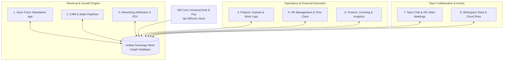

# 180 Workspace Suite Overview

**180 Workspace** is a modular enterprise operations operating system engineered to run companies, digital agencies, and modern teams without the friction, fragmented logins, and exorbitant per-seat costs of traditional SaaS stacks.

Instead of paying for 8–10 disparate SaaS subscriptions that require brittle Zapier syncs and constant manual copy-pasting, 180 Workspace binds all business operations into a single **Sovereign Work Graph**. When an event occurs in one application (e.g. a deal closes in the CRM), all downstream operations (invoicing, project provisioning, team channels, and client portals) trigger instantaneously in sub-5ms.

---

## The 8 Connected Applications

### 1. Voiceforce (AI Calling & Telephony)
- **Autonomous Phone Agents**: Sub-200ms ultra-low latency voice synthesis for inbound customer inquiries and outbound lead qualification.
- **Dedicated Virtual Numbers**: Instant provisioning of domestic and toll-free numbers.
- **CRM Ingestion**: Call transcripts, sentiment analysis, and audio recordings are automatically linked to customer records in the CRM.

### 2. CRM & Sales Pipelines
- **Visual Deal Pipelines**: Customizable drag-and-drop Kanban stages with automated lead scoring and win-probability predictions.
- **Proposal E-Signatures**: Send binding digital contracts with legally compliant electronic signatures.
- **Client Onboarding Automation**: Closing a deal automatically initiates downstream project provisioning and client folder creation.

### 3. Advertising Attribution & ROI
- **Closed-Loop Matchback**: Connects paid ad spend across Meta, Google, TikTok, and X directly to actual closed bank deposits and ledger entries.
- **Blended ROAS & MER**: Real-time visibility into blended Return on Ad Spend and Marketing Efficiency Ratio without pixel degradation.
- **Edge Routing & Cloaking**: Deep integration with 180 Traffic Director for zero-latency dynamic link tracking.

### 4. Projects, Kanban & Work Logs
- **High-Velocity Sprints**: Milestone roadmaps, flexible list/board/calendar views, and sprint backlogs.
- **Integrated Billable Time Tracking**: Developers and contractors log time directly against project tasks.
- **Automated Client Deliverables**: Client review checkpoints with one-click sign-off.

### 5. HR Management & Time Clock
- **Digital Time Clocking**: Clock-in and clock-out with geolocation fencing and IP verification.
- **Leave & Absence Policies**: Automated accrual tracking, holiday calendars, and approval workflows.
- **Direct Payroll Synchronization**: Aggregates logged work hours directly into compliant payroll ledgers.

### 6. Finance, Invoicing & Analytics
- **Dynamic Multi-Currency Invoicing**: Automated recurring billing, milestone invoices, and tax calculations (GST/VAT).
- **180 Pay Integration**: Direct one-click UPI and credit card settlement links embedded into invoice emails and client portals.
- **Real-Time Financial Ledger**: Cash flow forecasting, expense tracking, and profit margin analysis per client retainer.

### 7. Team Chat & HD Video Meetings
- **Zero Add-On Fees**: Built-in 1080p HD video conferencing with screen sharing and encrypted group calls.
- **Contextual Team Channels**: Channels automatically linked to specific clients, deals, or projects.
- **Threaded Communication**: Eliminates external Slack or Zoom subscriptions.

### 8. Workspace Tools & Cloud Drive
- **Collaborative Rich Docs & Wikis**: Real-time collaborative documents with nested pages and markdown export.
- **Enterprise Cloud Storage**: High-speed, encrypted asset storage with role-based folder permissions and public link sharing.
- **Client Asset Vaults**: Share deliverables directly with external stakeholders via branded client portals.

---

## Unified Multi-Company RBAC

Manage parent companies, subsidiaries, agencies, and separate client entities from a single unified switcher:

| Role | CRM & Sales | Operations & Projects | Finance & Billing | HR & Payroll | System & Security |
| :--- | :--- | :--- | :--- | :--- | :--- |
| **Owner** | Full Admin | Full Admin | Full Admin | Full Admin | Organization Root & API Keys |
| **Admin** | Full Admin | Full Admin | Invoicing & Approvals | Full Admin | User Management & Settings |
| **Manager** | Pipeline Access | Project Leads & Approvals | View Invoices | Team Clock & Leaves | Department Scopes |
| **Member** | Assigned Leads | Assigned Tasks & Work Logs | None | Personal Clock & Timesheets | Shared Assets & Channels |
| **Client / Guest** | Shared Proposals | Shared Milestones | Pay Invoices Only | None | Client Vault Only |

---

## The Work Graph Advantage

Unlike traditional SaaS suites stitched together with brittle webhooks:
- **Sub-5ms Event Propagation**: Changing a task status or closing a deal instantly updates connected finance ledgers and project boards.
- **Zero Webhook Failure Risk**: All 8 apps read and write to the same relational graph schema.
- **Unified Identity**: Single sign-on powered by **180 Core** (`profile.180core.cloud`), giving users one universal profile across all workspace modules.

---

## Workspace Documentation Directory

- **[Platform Overview](/docs/platform-overview)**: Sovereign Work Graph design principles and multi-tenancy.
- **[CRM & Sales Pipeline](/docs/products/180-workspace/crm-and-sales)**: Configure lead stages, customer books, and sales velocity tracking.
- **[Voiceforce AI Calling (Standalone)](https://voiceforce.vanityworkspace.com)**: Autonomous sub-200ms voice agents, virtual phone provisioning, and call analytics (deployed as standalone suite).
- **[Advertising Attribution](/docs/products/180-workspace/advertising-attribution)**: Multi-touch attribution models, Meta & Google Ad spend sync, and closed-loop ROI.
- **[Projects & Work Logs](/docs/products/180-workspace/projects-and-work-logs)**: Sprint boards, Gantt charts, real-time activity tracking, and automated timesheets.
- **[HR & Team Management](/docs/products/180-workspace/hr-and-team)**: Manage employees, leave policies, and payroll workflows.
- **[Finance & Invoicing](/docs/products/180-workspace/finance-and-invoicing)**: Setup multi-currency invoicing and automatic payment collection.
- **[Chat & Video Meetings](/docs/products/180-workspace/communications-and-meetings)**: Persistent team channels, ephemeral direct messages, and HD WebRTC conferencing.
- **[Tools & Cloud Drive](/docs/products/180-workspace/workspace-tools-and-docs)**: Collaborative documents, file storage, version control, and team utilities.
- **[Storage & Assets](/docs/products/180-workspace/storage-and-assets)**: Cloud storage organization, asset security, and permissions.
- **[Multi-Company Management](/docs/products/180-workspace/multi-company-management)**: Switch organizations and configure company-level security.
