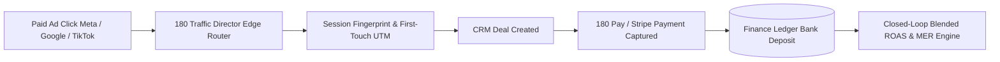

# Advertising Attribution & Closed-Loop ROI Architecture

**Advertising Attribution** eliminates guesswork for media buyers, growth marketers, and performance marketing agencies by matching every dollar of ad spend directly to closed revenue in the company ledger.



---

## 1. Architectural Highlights

- **First-Touch & Multi-Touch Attribution**: Captures raw UTM parameters, click IDs (`fbclid`, `gclid`, `ttclid`), referring domains, and browser device fingerprints.
- **Closed-Loop Matchback**: Unlike ad network pixels that inflate conversion numbers by claiming duplicate credit, 180 Workspace matches conversions exclusively to verified bank deposits and completed **180 Pay** transactions.
- **Blended ROAS vs. MER**: Computes real-time Marketing Efficiency Ratio (MER = Total Revenue / Total Ad Spend) alongside campaign-level Return on Ad Spend (ROAS).
- **Edge Routing & Cloaking**: Operates hand-in-glove with **180 Traffic Director**, evaluating bot traffic, cloaking sensitive landers, and routing traffic at Cloudflare edge with sub-10ms latency.

---

## 2. API Conversion Tracking Example

```typescript
import { WorkspaceClient } from '@180workspace/sdk';

const client = new WorkspaceClient({
  apiKey: process.env.WORKSPACE_API_KEY,
});

// Attribute an offline or server-side conversion back to campaign click
await client.advertising.recordConversion({
  transactionId: 'tx_9812401',
  revenueAmount: 1499.00,
  currency: 'USD',
  attributionId: 'attr_8a9b7c6d5e',
  conversionType: 'BANK_DEPOSIT_SETTLED',
});
```
