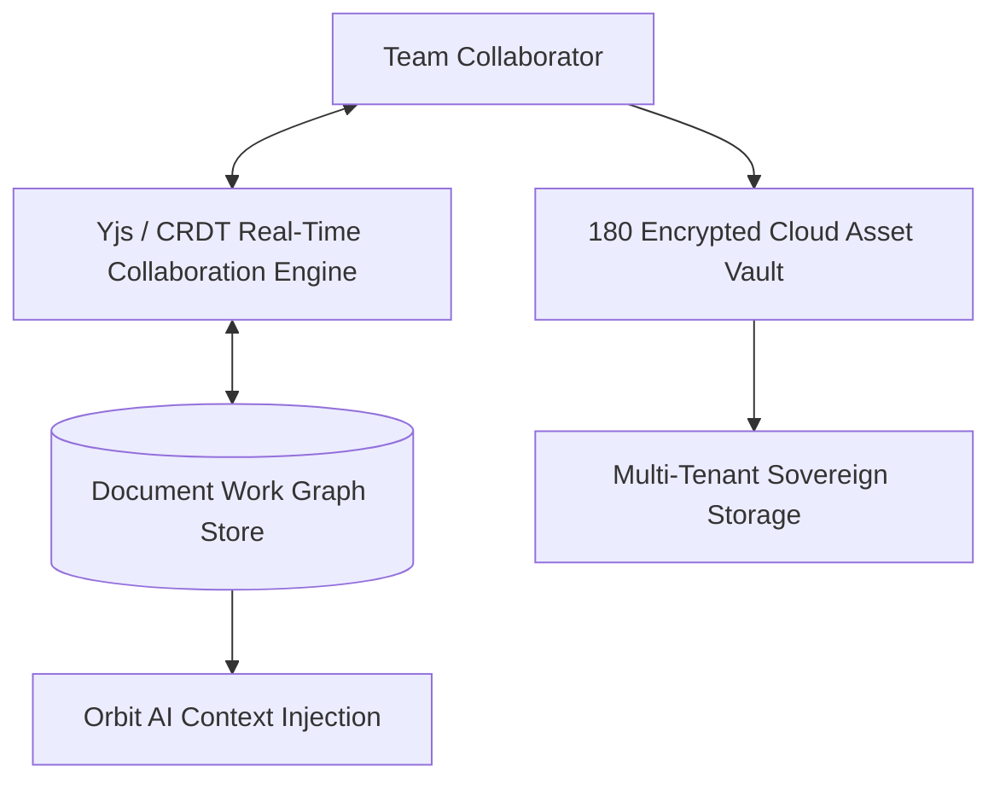

# Workspace Tools & Cloud Drive Architecture

**Workspace Tools & Cloud Drive** provides document collaboration and encrypted asset storage designed to replace Notion, Google Docs, and Dropbox for operating businesses.

---

## 1. Collaborative Documents & Wikis

- **Real-Time Multiplayer Editing**: Conflict-free Replicated Data Types (CRDTs) allow multiple team members to edit documents simultaneously with sub-15ms sync latency.
- **Rich Embeds**: Embed live Kanban boards, financial charts, 180 Pay checkout buttons, and interactive code blocks directly into wiki pages.
- **Role-Based Document Permissions**: Control view and edit access across company departments, managers, and external guests.

---

## 2. Enterprise Cloud Drive

- **High-Throughput Asset Storage**: Store 4K video rushes, raw graphics, client deliverables, and legal contracts.
- **Tenant-Isolated Encryption**: Every file upload is encrypted at rest using envelope encryption with per-company key derivation.
- **Direct Delivery to Clients**: Share secure, password-protected download links or branded client portal folders with zero egress bandwidth charges.
